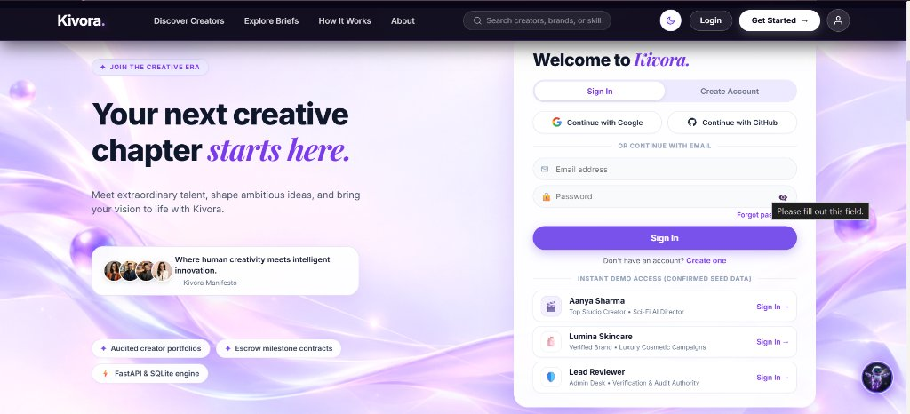

# Kivora — AI-Powered Content Creator Marketplace

**Connecting AI creators, brands and creative agencies through smart discovery, transparent workflows and voice-first assistance.**

> Built for **The Great Indian Internship Challenge by Gnani**


---

## About Kivora

Generative AI has changed how creative work is made. Creators now produce AI videos, digital fashion, 3D product visuals and cinematic content. But brands still find it hard to pick the right AI creator for a project.

Regular freelance sites are not built to judge AI-made work. Brands cannot easily see which tools a creator used, how the work was produced, or whether the creator can deliver what a campaign needs.

**Kivora fixes this.** Creators show their work and their process. Brands post clear campaign briefs, find the right creators and manage the whole collaboration in one place. A multilingual voice assistant, powered by Gnani AI, makes the platform easy to use in Telugu, Hindi and English.

---

## The Problem

- **Finding creators:** Brands cannot easily find creators with the exact AI tools and skills they need.
- **Weak portfolios:** Most portfolios show only the final output, not how it was made.
- **Unclear workflows:** It is hard to know which tools and steps were used to make an asset.
- **Messy briefs:** Brands often struggle to turn an idea into a clear, structured brief.
- **Scattered collaboration:** Applications, invitations, deliverables, revisions and approvals live in different tools.
- **Trust:** Brands need proof of what a creator can really do.
- **Language barrier:** Many creators and small brands are more comfortable in their own language than in English.

---

## Our Solution

Kivora gives creators and brands their own dedicated experience on one platform.

### For AI content creators
- Build a professional profile and portfolio
- Show AI tools, skills and specializations
- Share production workflows and supporting evidence
- Find relevant campaigns and apply with proposals
- Receive invitations and manage engagements
- Submit deliverables and handle revisions and approvals

### For brands and agencies
- Create a brand profile
- Build campaign briefs with AI help
- Publish requirements and creative specifications
- Search and filter creators, and get matched suggestions
- Review portfolios, skills and workflow evidence
- Review applications, send invitations and manage milestones
- Review deliverables and approve work

---

## Key Features

### Voice Assistant with Gnani AI
Kivo can be used by voice as well as by text. Users speak in Telugu, Hindi or English and hear the answer spoken back.

| Step | Technology |
|---|---|
| Speech to text | Gnani Prisma |
| Reasoning | Google Gemini with Kivora platform knowledge |
| Text to speech | Gnani Timbre |

```text
User speech -> Gnani Prisma -> Kivo chat flow -> Gemini -> Gnani Timbre -> Spoken reply
```

The text chat stays available next to the voice assistant. Language support depends on the verified capabilities of the Gnani models.

### Kivo, the AI Assistant
Kivo answers questions about the platform and helps with AI-assisted tasks. It uses Gemini for reasoning along with Kivora's own platform knowledge.

### Brand Portal

1. **Brand dashboard and profile:** A central place to manage the company profile and see key numbers such as total briefs, pitches received, active collaborations and completed work. Recent creator proposals and their status show up here too.
2. **Campaign creation with the AI Brief Builder:** Brands define objectives, target audience, timeline, required skills and preferred AI tools. The AI Brief Builder turns a rough idea into a structured brief, and the brand can review and edit it before going ahead.
3. **Save draft and publish:** A brief can be saved as a draft and changed later, then published when it is ready.
4. **Creator discovery and filters:** Brands search for creators and narrow the results by category, skills, AI tools, budget, location and verification status. Opening a creator profile shows their specializations and creative skills.
5. **Pitch proposals:** When creators apply to a published campaign, their proposals appear in the brand portal. Brands can review the pitch, proposed budget, timeline and how well the creator fits the campaign.
6. **Collaboration workspace:** Once a creator is selected, the workspace helps manage the project. Brands track progress, give feedback and review the final work for approval.

### Creator Portal

1. **Creator dashboard:** One workspace to manage the profile, show work, find campaigns and handle collaborations.
2. **Profile management:** Creators update their specializations and creative skills so brands understand their experience.
3. **Portfolio management:** Creators showcase their creative projects.
4. **Discover campaign briefs and filters:** Creators browse published briefs from brands and find the ones that match their specialization.
5. **Smart opportunities:** Kivora suggests campaigns that match a creator's skills, portfolio and creative interests.
6. **Saved briefs:** Creators save briefs to come back to later.
7. **AI-assisted pitch and applications:** Creators send a proposal that explains their approach, what they will deliver, their budget and their timeline. Under My Applications they can track the status of every pitch.
8. **Direct invitations:** Brands that like a creator's work can invite them directly.
9. **Notifications and direct chat:** Creators and brands talk through notifications and direct messages, so creators stay updated on decisions, invitations and collaboration changes.
10. **Deliverables and revisions:** After a proposal is accepted, creators submit deliverables, receive feedback and track progress until the brand approves the final work.
11. **Verification and proofs:** Creators add supporting evidence and workflow proofs. This helps brands understand the creator's process and trust their portfolio claims. An admin reviewer can verify and audit this evidence.

### Smart Matching
Creators are matched to campaigns using skills, AI tools, content specializations, portfolio relevance, technical requirements and budget fit.

---

## How It Works

1. **Join:** Creators and brands sign up, with email, Google or GitHub.
2. **Build a profile:** Creators add portfolios, tools and skills. Brands add their profile and needs.
3. **Create campaigns:** Brands publish structured briefs, with AI help from the brief builder.
4. **Discover:** Brands search and match with creators and review their work.
5. **Collaborate:** Creators apply, brands invite, and engagements begin.
6. **Produce:** Both sides work through milestones, deliverables, revisions and approvals.
7. **Ask Kivo:** Users get help by text or voice at any point.

---

## Screenshots

| Landing page | Sign in |
|---|---|
|  |  |

---

## Tech Stack

| Layer | Technology |
|---|---|
| Frontend | React, Vite |
| Backend | Python, FastAPI |
| Database | SQLite with SQLAlchemy ORM |
| API | REST |
| AI reasoning | Google Gemini |
| Speech to text | Gnani Prisma |
| Text to speech | Gnani Timbre |
| Authentication | Email, Google and GitHub sign-in, with role-based access |
| Deployment | Render (`render.yaml`) |

---

## AI Architecture

AI supports selected workflows. It does not replace the core marketplace logic.

- The React frontend handles all user interaction.
- The FastAPI backend handles application logic and API requests.
- Gemini powers the AI-assisted workflows and Kivo's answers.
- Kivora's knowledge resources keep Kivo's answers about the platform accurate.
- Gnani Prisma and Timbre add voice input and output on top of the same Kivo chat flow.

---

## Project Structure

```text
Kivora/
├── backend/
│   ├── app/
│   ├── scripts/
│   └── ...
├── frontend/
│   ├── src/
│   ├── public/
│   └── ...
├── docs/
│   └── screenshots/
├── .env.example
├── .gitignore
├── render.yaml
├── run.py
└── README.md
```

This is a short overview. See the repository for the full structure.

---

## Getting Started

### Prerequisites
- Python 3.10+
- Node.js and npm
- Git

### 1. Clone the repository
```bash
git clone https://github.com/ShaikArfaAnjum/Kivora.git
cd Kivora
```

### 2. Set up environment variables
Create a backend `.env` file from `.env.example` and add the keys the app needs (Gemini and Gnani credentials). Keep all AI keys on the backend only, and never commit real keys.

### 3. Start the backend
Install the backend dependencies from the project's dependency file, then start FastAPI. API docs are available at the backend `/docs` endpoint.

### 4. Start the frontend
```bash
cd frontend
npm install
npm run dev
```

### 5. Open the app
Open the URL shown in your terminal.

> Check `frontend/package.json` and the backend config for the exact scripts and ports.

---

## Demo Access

The login page has one-click demo accounts with seed data, so you can try each role quickly:

| Role | Demo account |
|---|---|
| Creator | Aanya Sharma, a sci-fi AI director |
| Brand | Lumina Skincare, a luxury cosmetics brand |
| Admin | Lead Reviewer, handles verification and audits |

---

## Security and Data Handling

- Protected user authentication
- Role-based access control
- Server-side validation
- Credentials managed through environment variables
- Private user data kept protected

API keys are never exposed in frontend code or committed to the repository.

---

## Future Roadmap

- Wider multilingual voice support across the whole platform
- Better creator verification and workflow evidence analysis
- Smarter AI creator matching
- Secure brand-to-creator payments with escrow milestones
- Campaign performance insights
- AI-suggested creator teams
- Campaign simulation and optimization

---

## Vision

We believe the future of creative work will be collaborative, AI-assisted and open to everyone, in every language.

**Discover talent. Showcase creativity. Build together.**

---

## Links

- GitHub: https://github.com/ShaikArfaAnjum/Kivora
- Built for: The Great Indian Internship Challenge by Gnani
