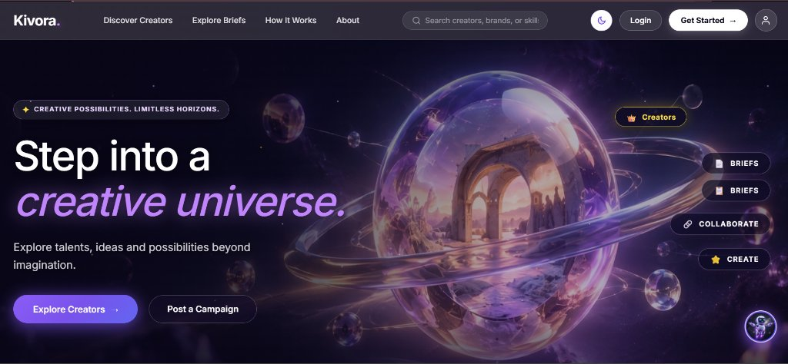
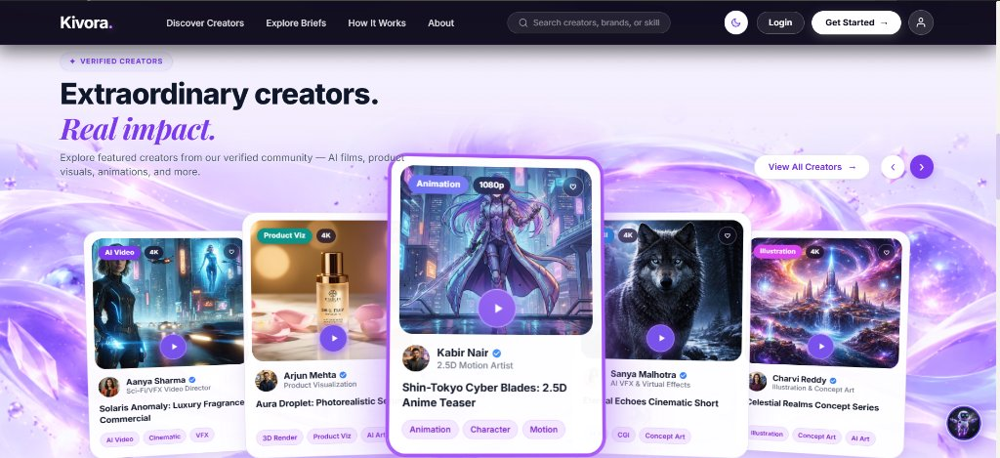
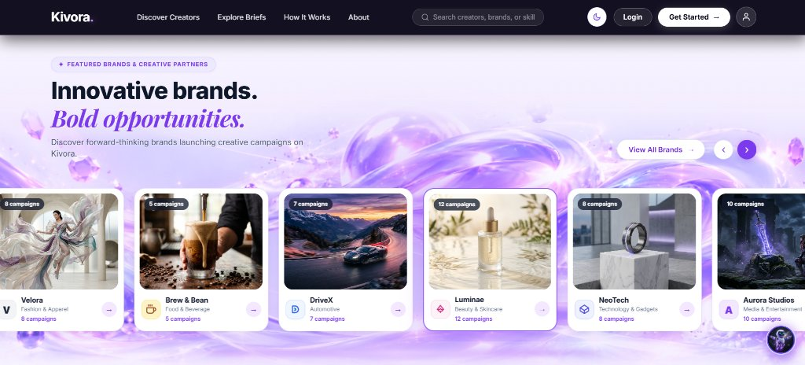

<div align="center">

# 🌌 Kivora
### The AI-Native Content Creator Marketplace
**Where Human Creativity Meets Intelligent Generative Innovation**

[](https://fastapi.tiangolo.com)
[](https://react.dev)
[](https://python.org)
[](https://ai.google.dev)
[-7952EC?style=for-the-badge)](https://gnani.ai)
[](https://sqlite.org)

<br/>

[-8B5CF6?style=for-the-badge&logo=adobe-acrobat-reader&logoColor=white)](./Kivora_Solution_Overview.pdf)
&nbsp;&nbsp;
[](#-quickstart--local-setup)

<br/>

> **Built for The Great Indian Internship Challenge by Gnani**  
> *Connecting AI creators, brands, and creative agencies through smart discovery, transparent workflows, verified portfolios, and voice-first assistance.*

</div>

---

## 📌 Executive Pitch & Overview

> [!IMPORTANT]
> **Executive Summary & Submission Deck**  
> Review our comprehensive one-page strategic brief:  
> 👉 **[📄 Click here to view the Kivora One-Page Solution Pitch (PDF)](./Kivora_Solution_Overview.pdf)**  
> *(Also accessible at [`docs/Kivora_Solution_Overview.pdf`](./docs/Kivora_Solution_Overview.pdf))*

---

## 🖼️ Actual Website Gallery

Experience the live Kivora platform interfaces designed for generative artists, production brands, and platform compliance administrators:

<div align="center">

### 1. Kivora Cosmic Universe — Creator Discovery & Marketplace Landing
*Explore verified creators, explore commercial briefs, and experience interactive creative universes.*



<br/>

### 2. Multi-Role Authentication & Onboarding Portal
*Secure passwordless and credentialed access with instant pre-seeded accounts for Creators, Brands, and Verification Admins.*


</div>

---

## 🛑 The Problem: The Generative Trust Deficit

Generative AI has fundamentally changed how creative work is made. Creators now produce AI videos, digital fashion, 3D product visuals, and cinematic commercial spots using tools like **Runway Gen-3, Kling, Midjourney, ComfyUI, and Flux.1 Pro**.

However, traditional freelance sites (Upwork, Fiverr) fail because they are not built to evaluate AI workflows:

1. **Prompts Are Not Reproducible Pipelines:** A creator who generates a lucky single still often cannot reproduce consistent lighting, seed control, and character continuity across a 60-second 4K commercial.
2. **Portfolio Hallucination & Stolen Renders:** Brands have zero guarantees that the creator actually synthesized the showcased asset, leading to unverified claims, stolen renders, and wasted budgets.
3. **Vague Commercial Briefs:** Brands unfamiliar with generative pipelines write ambiguous briefs, resulting in wasted GPU compute, mismatched aspect ratios, and endless revision loops.
4. **Scattered Collaboration & Trust Deficit:** Applications, invitations, deliverables, revisions, and milestone payments live in fragmented tools without verified proof of process.
5. **Language Barrier:** Many talented creators and small brands across India are far more comfortable speaking in their regional language (Telugu, Hindi) than writing in English.

---

## 💡 The Solution: Kivora's Proof-of-Workflow Marketplace

**Kivora** bridges the generative trust deficit by replacing unverified claims with verifiable proof artifacts:

* **Proof-of-Workflow Verification:** Creators submit verifiable evidence (ComfyUI node graphs, intermediate passes, camera trajectory logs, prompt parameters) audited by human reviewers before earning the `VERIFIED_PRO` or `TOP_STUDIO` badge.
* **AI-Assisted Structured Brief Builder:** Converts conversational brand objectives into rigorous production briefs specifying aspect ratios (16:9, 9:16, 1:1), 4K resolutions, revision allowances, and commercial license buyouts.
* **Explainable Matching Engine:** Matches briefs against creators based on a 4-dimensional scoring model (Skill Match, Tool Capability, Aesthetic Style, and Budget Fit).
* **Milestone Escrow Workspaces:** Payments and deliverables are structured in milestone contracts (`KICKOFF` $\rightarrow$ `DRAFT_SUBMITTED` $\rightarrow$ `REVISION` $\rightarrow$ `FINAL_APPROVED`) ensuring mutual trust.
* **Kivo AI Multilingual Co-Pilot:** A friendly, grounded conversational concierge powered by **Google Gemini 3.8 Flash** with **Gnani AI voice capabilities in progress** (English, Hindi, Telugu).

---

## 🚀 Core Features & Marketplace Portals

<div align="center">

### 🎨 Verified Creator Community & Portfolios
*Audited generative AI directors, 3D artists, and VFX creators with transparent tool stacks.*



<br/>

### 🏢 Featured Brands & Active Commercial Briefs
*Enterprise brands and creative studios launching production briefs on Kivora.*



</div>

### 1. 🎨 Creator Portal
* **Verified Portfolio Deep-Dives:** Display high-resolution outputs with technical metadata (Aspect Ratio, Resolution, Tools Used, Licensing Tiers).
* **Proof-of-Workflow Evidence:** Upload ComfyUI workflows, ControlNet passes, and prompt logs for administrative audit.
* **AI Proposal Pitch Assistant:** Generates brief-aligned pitch proposals grounded strictly in the creator's real portfolio and tools.
* **Real-Time Deliverables Tracker:** Track active engagements and milestone progress in real time.

### 2. 🏢 Brand Portal
* **AI-Assisted Brief Builder:** Conversational or prompt-driven brief synthesis with instant formatting into industry-standard deliverables.
* **Filterable Creator Discovery:** Search verified generative artists by creative domain, tools (Runway, ComfyUI, Midjourney), minimum budget, and verification tier.
* **Applicant Review & Direct Invitations:** Compare applicants with transparent matching scores and invite top talent directly.
* **Milestone Escrow Management:** Release milestone funds only after approving watermarked drafts and final master deliverables.

### 3. 🛡️ Admin Verification Desk
* **Human-in-the-Loop Audit Queue:** Review creators' uploaded workflow evidence, node graphs, and generation logs.
* **Tier Governance:** Promote creators from `UNVERIFIED` to `VERIFIED_PRO` or `TOP_STUDIO`.
* **Platform Security Oversight:** Inspect active engagements and platform trust compliance.

### 4. 💬 Collaboration & Direct Messaging
* **Contextual Conversations:** Creator-brand messaging linked directly to campaign briefs and pitches.
* **Deliverable Review & Approval:** Integrated file submissions and client review summaries.

---

## 🤖 AI & Voice Capabilities

### Google Gemini 3.8 Flash — Core Reasoning Engine
Gemini serves as Kivora's primary reasoning engine across the platform:
* **AI Brief Builder:** Synthesizes commercial objectives into structured briefs.
* **Pitch Proposal Assistant:** Formulates brief-tailored creator pitches grounded strictly in verified portfolio facts.
* **Creative Deliverable Evaluation:** Evaluates uploaded deliverables against brief guidelines.
* **Kivo AI Concierge:** Real-time conversational co-pilot grounded in `backend/app/data/kivora_knowledge_base.json`.

### 🎙️ Gnani AI Voice Integration *(In Progress)*
We are actively integrating **Gnani AI voice capabilities** into Kivo AI to enable hands-free voice interactions:
* **Gnani Prisma STT (`prisma-v3.0`):** Speech-to-Text transcription with verified low-latency performance across **English (`en-IN`)**, **Hindi (`hi-IN`)**, and **Telugu (`te-IN`)**.
* **Gnani Timbre TTS (`timbre-v3.0`):** Natural spoken speech synthesis with expressive vocal delivery (Default voice: `Shivani`).
* **Dedicated Full-Screen Voice Assistant:** Features real-time audio waveform visualizers, language pickers, and audio playback controls.
* *Status:* Backend services and API endpoints (`/api/voice/config`, `/api/voice/transcribe`, `/api/voice/synthesize`, `/api/voice/kivo-voice-chat`) and frontend voice components are integrated and undergoing progressive refinement.

```text
User Speech (Mic) ──► Gnani Prisma STT ──► Kivo Engine ──► Gemini 3.8 Flash ──► Gnani Timbre TTS ──► Spoken Audio Playback
```

---

## 🛠️ Complete Tech Stack

| Layer | Technology | Details |
| :--- | :--- | :--- |
| **Frontend** | React 19, Vite 8, Tailwind CSS | High-performance SPA with cosmic dark-mode luxury aesthetics and glassmorphism |
| **Backend API** | FastAPI, Python 3.11 | High-throughput async REST API with Pydantic v2 schemas and CORS middleware |
| **Database** | SQLite + SQLAlchemy 2.0 ORM | Normalized relational schema with foreign key enforcement and transactional safety |
| **Reasoning Engine** | Google Gemini (`gemini-3.8-flash`) | GenAI SDK with grounded platform prompt templates and deterministic fallbacks |
| **Voice AI Engine** | Gnani AI (`prisma-v3.0`, `timbre-v3.0`) | Multilingual Speech-to-Text and Text-to-Speech via Vachana developer platform *(In Progress)* |
| **Authentication** | PyJWT, bcrypt (12 rounds) | Stateless JWT tokens, role-based access control (RBAC), and email OTPs |
| **Audio Processing** | Web Audio API, MediaRecorder | Client-side audio visualizer, frequency spectrum analysis, and RIFF/WAVE stream packaging |
| **Automated Testing** | Pytest, FastAPI TestClient | Comprehensive test suites for auth, briefs, matching, AI assistance, and voice pipelines |

---

## 👥 Instant Evaluation Accounts (Pre-Seeded)

The database includes pre-configured demo accounts for immediate hackathon evaluation without requiring manual registration:

| Portal Role | Demo Name | Email Address | Password | Profile Highlights |
| :--- | :--- | :--- | :--- | :--- |
| **Creator** | Aanya Sharma | `aanya@kivora.dev` | `Password123!` | Top Studio Creator • Sci-Fi AI Director • ComfyUI & Runway Gen-3 |
| **Creator** | Elena Rostova | `elena@kivora.dev` | `Password123!` | Verified Pro • 4K Luxury Cosmetics & Fluid Dynamics Specialist |
| **Brand** | Lumina Skincare | `lumina@kivora.dev` | `Password123!` | Verified Luxury Brand • High-Fashion & Skincare Video Campaigns |
| **Brand** | Veloce Motors | `veloce@kivora.dev` | `Password123!` | CGI Automotive & Futuristic Mobility Brand |
| **Admin** | Lead Reviewer | `admin@kivora.dev` | `AdminPass123!` | Admin Desk Verification & Workflow Evidence Audit Authority |

---

## 💻 Quickstart & Local Setup

### 1. Prerequisites
* **Python 3.10+** (Python 3.11 recommended)
* **Node.js 18+** & **npm**

### 2. Clone the Repository
```bash
git clone https://github.com/ShaikArfaAnjum/Kivora.git
cd Kivora
```

### 3. Backend Setup & Local Server
```bash
cd backend

# Create and activate virtual environment (Optional but recommended)
python -m venv venv
venv\Scripts\activate   # On Windows
# source venv/bin/activate # On macOS/Linux

# Install backend dependencies
pip install -r requirements.txt

# Configure environment variables
copy .env.example .env    # On Windows
# cp .env.example .env    # On macOS/Linux

# Run the backend server from project root or backend
cd ..
python run.py
```
> The FastAPI backend will be live at: **`http://localhost:8000`**  
> Interactive Swagger API Documentation: **`http://localhost:8000/docs`**

### 4. Frontend Setup & Local Server
Open a second terminal window:
```bash
cd frontend

# Install frontend dependencies
npm install

# Start Vite development server
npm run dev
```
> The Kivora web application will be live at: **`http://localhost:5173`**

---

## 🧪 Testing & Verification

Run the automated test suites from the `backend/` directory:

```bash
cd backend

# 1. Run Gnani Voice Service & Endpoint Tests
python -m pytest tests/test_voice_service.py -v

# 2. Run Matching Engine & Scoring Tests
python -m pytest tests/test_matching_engine.py -v

# 3. Verify Frontend Production Build
cd ../frontend
npm run build
```

---

## 📂 Project Directory Structure

```text
Kivora/
├── Kivora_Solution_Overview.pdf          # 📄 One-Page Solution Pitch Document
├── README.md                             # 🌟 Master Project Documentation
├── kivora.db                             # 🗄️ Seeded Relational Database
├── run.py                                # 🚀 Unified Production Server Runner
├── screenshots/                          # 🖼️ Platform UI Screenshots Gallery
│   ├── kivora_hero_universe.jpg
│   ├── kivora_auth_portal.jpg
│   ├── landing.png
│   └── login.png
├── docs/                                 # 📚 Comprehensive Architecture & Reports
│   ├── Kivora_Solution_Overview.pdf      # 📄 Solution Pitch PDF Backup
│   ├── PHASE_2_VOICE_INTEGRATION_REPORT.md
│   ├── PHASE_2_INSPECTION_REPORT.md
│   └── screenshots/
├── backend/                              # ⚡ FastAPI Python Backend
│   ├── app/
│   │   ├── api/                          # REST API Route Controllers
│   │   │   ├── auth.py                   # JWT & OAuth Endpoints
│   │   │   ├── ai.py                     # Gemini AI Brief & Kivo Chatbot
│   │   │   ├── voice.py                  # Gnani Prisma STT & Timbre TTS
│   │   │   ├── creators.py               # Creator Profiles & Discovery
│   │   │   ├── briefs.py                 # Campaign Briefs & Applications
│   │   │   ├── matching.py               # 4-Tier Matching Engine
│   │   │   ├── messages.py               # Direct Messaging
│   │   │   └── verification.py           # Admin Evidence Audit Desk
│   │   ├── core/                         # Config & Security Utilities
│   │   ├── models/                       # SQLAlchemy Relational Models
│   │   ├── schemas/                      # Pydantic Request/Response Models
│   │   ├── services/                     # Business Logic & AI Services
│   │   │   ├── gnani_service.py          # Gnani Voice STT & TTS Orchestrator
│   │   │   ├── brief_builder.py          # AI Brief Synthesis Engine
│   │   │   ├── pitch_assistant.py        # Proposal Pitch Assistant
│   │   │   └── kivo_knowledge.py         # Grounded Knowledge Retriever
│   │   └── data/
│   │       └── kivora_knowledge_base.json# Verified Platform Knowledge
│   ├── tests/                            # Automated Pytest Suites
│   └── requirements.txt                  # Python Dependencies
└── frontend/                             # ⚛️ React 19 + Vite Frontend
    ├── src/
    │   ├── components/                   # UI Modules & Modals
    │   │   ├── FloatingKivoChatbot.jsx   # Kivo AI Concierge & Voice Trigger
    │   │   ├── KivoVoiceAssistantModal.jsx # Full-Screen Voice Modal
    │   │   ├── MessagesInbox.jsx         # Messaging
    │   │   ├── CreatorDashboard.jsx      # Creator Workspace
    │   │   ├── BrandDashboard.jsx        # Brand Campaign Desk
    │   │   └── AdminDashboard.jsx        # Admin Verification Desk
    │   ├── services/                     # API Client Services
    │   ├── utils/
    │   │   └── useVoiceRecorder.js       # Browser Audio Stream & Visualizer Hook
    │   ├── App.jsx                       # Master Routing & State Controller
    │   └── App.css                       # Cosmic Dark Luxury Styles
    └── package.json                      # Frontend Dependencies
```

---

## 📄 Key Documentation Links

* **One-Page Solution Pitch:** [`Kivora_Solution_Overview.pdf`](./Kivora_Solution_Overview.pdf)
* **Phase 2 Voice Integration Report:** [`docs/PHASE_2_VOICE_INTEGRATION_REPORT.md`](./docs/PHASE_2_VOICE_INTEGRATION_REPORT.md)
* **Pre-Implementation Inspection Report:** [`docs/PHASE_2_INSPECTION_REPORT.md`](./docs/PHASE_2_INSPECTION_REPORT.md)

---

<div align="center">

**Kivora** — Pioneering Trust & Verified Excellence in the Generative AI Era.  
*Built for The Great Indian Internship Challenge by Gnani*

</div>
